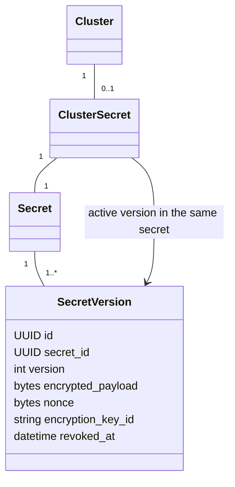

# Cluster credentials and connection testing

This phase implements cluster scope from the secret-storage plan. Application
scope waits for installed-application records and real namespace bindings.



The cluster association is required at commit time. Its active-version composite
foreign key prevents selecting another secret's version. Cluster deletion is
protected while credentials exist. Credential replacement creates a new logical
version; activation can select an existing non-revoked version. Revocation blocks
new resolution and does not revoke credentials already accepted by Kubernetes.

The existing cryptography library provides AES-256-GCM with fresh 12-byte nonces.
Authenticated context binds secret identity, version identity/number and cluster
identity. Original bytes are encrypted directly. Keys live in an operator keyring
outside PostgreSQL. Rotation changes encryption keys without changing logical
version IDs and runs in bounded, resumable CLI batches. Missing keys and failed
authentication tags fail closed. Keep backups of required old keys until rotation
is complete and backup recovery has been verified.

Owner-only versioned APIs return nested public metadata through the shared
presenter. Kubeconfig is write-only; neither metadata, logs, audit snapshots nor
errors include the confidential document. There is no plaintext read endpoint.
Future application payloads will use the same byte-encryption boundary with their
own actual scope associations.

The manual connection test uses the official Kubernetes Python SDK native async
client (`kubernetes.aio`) and verified TLS. Network requests are awaitable; bounded
filesystem and TLS setup run outside the event loop. Embedded
certificate authority/client certificate/key data and bearer tokens are supported.
External files, executable authentication plugins, proxies, redirects and insecure
TLS are rejected. HTTPS base paths are preserved for Kubernetes proxies such as Rancher.
The current context chooses the endpoint; private LAN endpoints
are intentional for self-hosted clusters. Only instance owners may set or test it.
An authenticated SelfSubjectReview precedes version discovery, so a publicly
readable version endpoint cannot create a false authentication success.

Tests cover ciphertext and exact byte round trips, scope/tamper/revocation denial,
concurrent version creation, active-version isolation, key rotation, authorization,
public schemas, audit/log leakage, real TLS token and client-certificate exchanges,
timeouts, cancellation and metadata-only errors. No queue or background worker
infrastructure is introduced. One migration owns this phase's schema changes.

Protocol references: [authenticated encryption](https://cryptography.io/en/latest/hazmat/primitives/aead/),
[kubeconfig](https://kubernetes.io/docs/reference/config-api/kubeconfig.v1/), and
[authenticated identity review](https://kubernetes.io/docs/reference/access-authn-authz/authentication/#api-access-to-authentication-information-for-a-client).

## Operator configuration

Select `TINYPODS_SECRET_KEY_PROVIDER=environment` (the default) or `file`.
The environment provider reads `TINYPODS_SECRET_KEYS`, a JSON mapping of stable
key identifiers to Base64-encoded 32-byte keys. The file provider reads that same
JSON mapping from the absolute operator-selected `TINYPODS_SECRET_KEY_FILE` path;
leave environment keys empty when selecting a file. Both providers use
`TINYPODS_SECRET_ACTIVE_KEY_ID` for new writes. No mount location or deployment
technology is assumed. Compose forwards the selection; operators supply any
required read-only file mount themselves.

The shared async provider interface separates persistence from key access. File
reads are asynchronous and bounded, with no retained key cache. Unreadable or
invalid files fail closed without falling back to environment keys. Metadata
access does not require opening the key file. Without configured keys, credential
writes/resolution fail closed while ordinary features remain available.

Keep real keys and local configuration outside Git and the image build context.
A protected file reduces accidental configuration exposure; it does not isolate
keys from a compromised backend. An external key service can implement the same
provider interface later, but is not required or implemented in this phase.

Configure the new active key alongside all old read keys, then run
`tinypods secrets rotate-key --batch-size 100` repeatedly. Each invocation commits
one batch and reports `updated` and `remaining`. A failed batch rolls back. Zero
remaining covers the current database, not old backups or external credential
revocation. Keep old keys until the required recovery window is covered.

## API sequence

All routes are under `/api/v1` and require a live instance-owner session. Unsafe
calls also require the existing CSRF header. Read DTOs use nested public metadata.

1. POST `/clusters/{cluster_id}/kubeconfig/versions` with write-only `kubeconfig` and explicit
   `encoding` (`plain`, the default, or `base64`). Plain accepts UTF-8 YAML/JSON;
   Base64 accepts a standard single-line encoding of those same bytes
   and optional `activate` (defaults true). The first upload creates the internal
   secret automatically; later uploads append versions. Set false to stage.
2. GET `/clusters/{cluster_id}/kubeconfig` for active-version metadata.
3. GET `/clusters/{cluster_id}/kubeconfig/versions` for paginated history, or
   append `/{version_id}` for one version belonging to that cluster.
4. POST `/clusters/{cluster_id}/kubeconfig/versions/{version_id}/activate` without
   a body to activate a non-revoked version belonging to that cluster.
5. POST `/clusters/{cluster_id}/testConnection` without a body for diagnostics.
6. POST `/clusters/{cluster_id}/kubeconfig/versions/{version_id}/revoke` without
   a body to permanently block resolution. Revoking the active version does not
   silently select an older one.

Callers manage kubeconfig entirely through the cluster. Internal secret IDs and
separate secret resources are not exposed. Metadata is shaped as:

```json
{
  "cluster": {
    "id": "cluster-uuid",
    "name": "Cluster 1",
    "slug": "cluster-1",
    "region": {
      "id": "region-uuid",
      "name": "Gurugram",
      "slug": "gurugram",
      "flag": null
    }
  },
  "active_version": { "id": "version-uuid", "version": 1, "revoked_at": null }
}
```

This abbreviated response omits unchanged audit timestamps and uses UUID
placeholders. There is no `kubeconfig`, token, private key, nonce or ciphertext in
this response. Connection success returns only `connected`, a fixed `reason`, and
`kubernetes_version`. Transport failures return fixed diagnostic categories.

Python's TLS client-certificate loader requires file paths. It loads embedded
material through exclusive 0600 files in a private temporary directory and removes
them before network I/O. The standard Compose runtime mounts `/tmp` as tmpfs.
Outside that runtime, use an appropriately protected memory-backed temporary
filesystem if avoiding all disk copies is required. Process memory and TLS state
remain sensitive; Python does not provide guaranteed memory erasure.

Switch every credential-writing process to the new active key before relying on a
final zero-remaining count. The rotation command does not update other processes'
configuration or fence a stale writer. Keep old keys available during the rollout,
repeat verification after writers have switched, and cover retained backups before
retirement. An active credential can remain in flight while it is revoked; future
resolution is blocked, while external credential revocation is a separate operation.

The test requires permission to create an `authentication.k8s.io/v1`
`SelfSubjectReview`. It confirms verified TLS, authenticated identity and version
discovery. Deployment permissions and cluster readiness require their own checks.
Use an endpoint reachable from the backend; a kubeconfig loopback address refers
to the backend's host/container. Server names must match the TLS certificate.

Generate an independent operator key with the installed encryption library, then
store its output in protected, ignored operator configuration:

```sh
uv run --no-sync python -c "import base64; from cryptography.hazmat.primitives.ciphers.aead import AESGCM; print(base64.urlsafe_b64encode(AESGCM.generate_key(bit_length=256)).decode())"
```

For example, use `TINYPODS_SECRET_KEYS={"primary":"<generated-key>"}` and
`TINYPODS_SECRET_ACTIVE_KEY_ID=primary`. The placeholder is not a usable key.
Base64 is used for key transport; confidential payload bytes are encrypted directly.

Base64 is only the upload transport, not encryption. Strict decoding rejects malformed
encoding and decoded payloads over 262144 bytes before parsing. Encryption protects
the original decoded document bytes. Embedded certificate fields remain unchanged.
