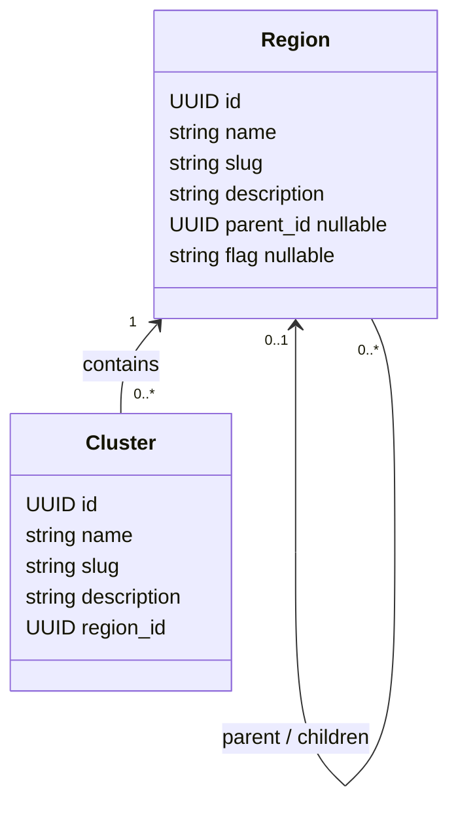

# Regions and clusters

Regions are a geographic tree. Each registered Kubernetes cluster belongs to one
region, including a single-node Raspberry Pi cluster. A cluster registration is
metadata: it does not contact Kubernetes or contain kubeconfig, credentials,
connection status or installed application state. No records are seeded automatically.



A region slug is unique among siblings, including roots. Cluster names and slugs
are case-sensitive and unique within their region. India / Gurugram and United
States / California can each contain a cluster named `Cluster 1`, slug `cluster-1`;
the global UUID distinguishes them. Moving a cluster preserves its UUID and fails
with a conflict if its name or slug collides at the destination.

## APIs

`/api/v1/regions` and `/api/v1/clusters` use the standard list, retrieve, create,
replace, patch and delete resource actions. Reads require a current authenticated
session. Writes require current instance-owner rights, matching CSRF proof, and the
shared resource rate limits. Shared response caching is not enabled for these
protected resources. Mutations use automatic audit history and sanitized errors.

Lists accept `limit`, `offset`, `q`, `ordering` and `slug`. Regions additionally
accept `parent_id` for direct children or `roots=true` for roots; the two filters
cannot be combined. Clusters accept `region_id` for directly assigned clusters,
not every descendant region. Ordering is name or created time, optionally prefixed
with `-`, with UUID as the stable tie-breaker.

A region body has `name`, `slug`, optional `description`, nullable `parent_id`, and
nullable `flag`. A cluster body has `name`, `slug`, required `region_id`, and optional
`description`. PATCH preserves omitted fields. PUT replaces writable state using
the complete input contract. Unsupported fields, including credentials and private
hierarchy paths, are rejected. Required fields cannot be explicitly null.

## Visual flags

`flag` accepts a credential-free HTTP(S) image URL. The backend validates the URL
but never fetches the image. Setting it creates a region-local override; clearing
it to null restores inheritance. Responses return the nearest ancestor's flag
when the region has no override. With no matching override, the result is null.
Only the explicit override is stored. Parent flag changes and subtree moves affect
inherited reads immediately after commit, without copying flags to descendants.

When editing a region, send only changed fields through PATCH. Copying an inherited
response flag into a write explicitly creates a local override. PUT with flag
omitted restores inheritance, just like an explicit null.

## Hierarchy integrity and indexing

Foreign keys protect parent regions and registered cluster regions from deletion.
Delete or move their dependent records first. Region identity is immutable, and
the database rejects self-parenting, missing parents and cycles even through direct
SQL. The migration adds these models in one revision and seeds no location data.

A private UUID-array path stores the root-to-node ancestry. Database triggers
compute it on insert and atomically rewrite descendants on a move. It is not an API
field or an independently editable setting. The partial index on flagged region IDs
supports one batched inherited-flag query per page, without recursive traversal on
reads. UUID paths avoid adding a database extension or coupling ancestry to names.

Structural statements acquire a transaction-scoped hierarchy lock before tuple/FK
locks. Structural edits are serialized, including cross-root moves; ordinary reads
and flag/name edits do not acquire that lock. A large subtree move still rewrites
its descendant paths and can delay other structural edits or conflicting row writes.
Reads use PostgreSQL MVCC and do not wait for an uncommitted path/flag update.
Database privileges that disable triggers can bypass these invariants; ordinary API
and SQL writes cannot edit derived paths.

The migration's trigger functions use built-in UUID/array types and schema-qualified
table references. Restore/migration regression coverage verifies that the functions
can be recreated with a restricted search path. Backups must retain the triggers.

## Verification and next phase

The tests exercise flag inheritance and overrides, clearing and reparenting,
region-local identities, protected deletion, current-owner authorization, migration
round-trips, and concurrent moves through direct PostgreSQL and transaction pooling.
The benchmark script compares recursive lookup, indexed recursion and materialized
ancestry on disposable services and saves EXPLAIN/buffer and latency data beneath
`reports/benchmarks/`:

```sh
uv run --no-sync python scripts/benchmark_region_flags.py
uv run --no-sync python scripts/benchmark_region_flags.py --unprepared
```

The following phase adds encrypted, versioned cluster credentials and read-only
connection/capability checks. Kubeconfig will be a scoped secret linked by foreign
key, rather than a field in cluster registry responses. Installed applications and
application-scoped secrets follow their actual resource models. Queues, background
jobs and billing are outside this registry implementation.
